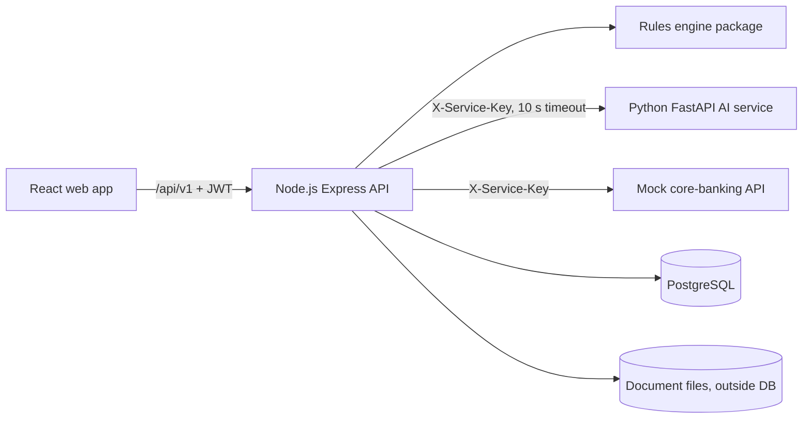

# OnboardIQ – Design Document

Use case 02 (BFSI, KYC onboarding) for Deccan Digital Bank (fictional). All data is synthetic.

Diagrams in this folder (Mermaid source + rendered SVG):

| File | Content |
|---|---|
| `architecture.svg` | Components and trust boundaries |
| `rules_flowchart.svg` | Evaluation of R1–R17, precedence and routing |
| `status_lifecycle.svg` | Application status lifecycle (6.1.1) |
| `er_diagram.svg` | Database ER diagram |
| `openapi.json` | OpenAPI 3.0 specification (also live at `/api/v1/openapi.json`, Swagger UI at `/api/docs`) |

---

## 1. Architecture



| Layer | Technology | Responsibility |
|---|---|---|
| Web | React 19, TypeScript, Vite, hand-written CSS design system, react-icons | Applicant portal (form, upload, tracking, resubmission); KYC workbench; checker queue; dashboard; audit; rules and watchlists |
| API | Node.js 22, Express 4, TypeScript (run with tsx), Zod, jsonwebtoken (HS256), bcryptjs, multer, node-postgres | Auth and roles, validation, uploads, extraction-provider interface, workflow and maker-checker, rules execution, mock core banking, audit, dashboard, batch CLI |
| Rules engine | `packages/rules-engine` (pure TypeScript, no I/O) | R1–R17, name normalisation, Levenshtein, watchlist screening, risk, re-KYC; shared by the API and the batch command |
| Shared | `packages/shared` | Zod schemas, constants, reason-code messages, masking (used by API and web) |
| AI service | Python 3.12, FastAPI, scikit-learn | Classification (guardrail + weighted keywords + TF-IDF/LR), field extraction with OCR correction, confidence, reviewer summary |
| Database | PostgreSQL 16 | All state; append-only audit enforced by trigger |
| Tooling | Turborepo, npm workspaces, Docker / Compose, GitHub Actions, node:test, pytest, Playwright (UI walkthrough) | |

## 2. End-to-end workflow mapping (workflow image → implementation)

| Workflow step (image) | Implementation |
|---|---|
| Applicant registers / logs in | `POST /auth/register`, `POST /auth/login` (JWT) – Login page |
| Complete application + mandatory KYC consent; validate PAN format, Aadhaar last 4, mobile, PIN, DOB | Wizard step 1; client Zod + `POST /applications/validate` (server Zod, HTTP 422 with field names; 12-digit Aadhaar refused) |
| Input valid? No → HTTP 400/422, show field errors, applicant corrects | Field errors shown inline; step does not advance |
| Upload ≥3 UTF-8 .txt documents, declared type, ≤1 MB, SHA-256 idempotency, store outside DB | Wizard step 2 (client checks) + `POST /applications` multipart: extension, size (413), UTF-8, binary/exe signatures, per-file declared type; SHA-256 de-duplication; files stored under random UUID keys in `storage/` |
| Valid document? No → ask user to upload a valid document | HTTP 422 `INVALID_DOCUMENT` with per-file messages; nothing stored |
| Persist application + docs metadata, status SUBMITTED → EXTRACTING | One DB transaction inserts application + documents (SUBMITTED); in-process queue moves to EXTRACTING |
| Call extraction adapter per document; unknown / failed / timeout → confidence 0 | `ExtractionProvider` (mock or ai) per document, 10 s timeout, OTHER/0.00 on failure |
| Run all applicable R1–R17; use fields only when confidence ≥ 0.80; name score + sanctions/PEP + duplicate | `evaluateApplication()` in `packages/rules-engine` |
| Final rules decision REJECT → AUTO_REJECTED, show plain-language reason codes | Routing; applicant sees `applicantMessage` for every code |
| APPROVE + LOW/MEDIUM → AUTO_APPROVED; HIGH → PENDING_CHECKER | `routeDecision()` |
| REVIEW → IN_REVIEW, queue HIGH risk first then submission time | `GET /review/queue` ordered by risk then `submitted_at` |
| KYC Officer reviews text + extracted fields; corrections → confidence 1.00, source OFFICER; rerun rules (all audited) | Workbench: document text with highlighted spans, fields with confidence bars; `POST /applications/{id}/corrections` re-runs rules, audits before/after; every document view audited |
| Maker recommendation APPROVE / REJECT → checker; REQUEST_RESUBMISSION → applicant re-uploads within 7 days; no resubmission → CLOSED_EXPIRED | `POST /applications/{id}/recommendation`; resubmission upload/remove/resubmit endpoints; expiry job every minute + `POST /admin/jobs/expire` |
| Compliance Checker decision – must be a different user from maker | `POST /applications/{id}/checker-decision`; same user → HTTP 403 (+ DB CHECK constraint) |
| Checker REJECT → REJECTED; APPROVE → final approval | Transitions in one transaction |
| Call mock core-banking API with service key from environment | `openAccount()` → `/internal/core-banking/accounts` (X-Service-Key = `SERVICE_KEY`) |
| Persist customer ID + account number; applicant sees final status + safe reasons | Stored on the application and in `existing_customers`; applicant view shows account details |
| Append-only audit trail (status, decision, field before/after, watchlist hit, document view, actor, role, timestamp, doc_id) | `audit_log` table with UPDATE/DELETE/TRUNCATE trigger; per-application history + CSV export (PAN masked) |

## 3. Rules engine

Implemented exactly as Section 6.1 (see `rules_flowchart.svg`). Key points:

* **Document selection** – each document takes the classified doc_type; lowest doc_id per type; address proof = lowest doc_id among the configured address-proof types.
* **Usable field** – present, not empty, confidence ≥ `min_field_confidence`. R6–R14 are skipped (`evaluated: false`) when their field is not usable.
* **Name normalisation** – upper case; `.`/`-` → space; drop non A–Z; drop title tokens; collapse; sort tokens. Similarity = 1 − Levenshtein / longer length. Score = minimum over usable PAN/Aadhaar names. Rounded to 4 decimals only for output.
* **Screening** – name and alias; MATCH = sim ≥ 0.90 with dob empty or equal; POSSIBLE = sim ≥ 0.90 with different dob, or 0.80 ≤ sim < 0.90.
* **Precedence** – REJECT if any R4–R10; otherwise REVIEW if any R1–R3/R11–R17; otherwise APPROVE. Reason codes in rule order joined with `|`.
* **Risk / re-KYC** – HIGH (PEP_MATCH, SANCTIONS_POSSIBLE_MATCH or HIGH occupation), MEDIUM (MEDIUM occupation or income ≥ threshold), else LOW; +2/8/10 years with 29 Feb → 28 Feb; empty for REJECT.
* **Configuration** – every threshold, the PAN pattern and holder character, title tokens, re-KYC periods, SLA values come from `rules_config` (seeded from `case_02_rules_config_V1.0.json`, versioned on each change). Watchlists, customers and occupations are tables.
* **Explainability** – every rule result carries the compared values (e.g. declared vs card PAN, normalised names and similarity, matched list entry and dob comparison); the workbench shows them.

Verification: `npm run verify:sample` → 60/60 sample applications match all expected columns; the seeded database reproduces the same values.

## 4. Extraction-service interface (FR-3)

```ts
interface ExtractionProvider {
  name: 'mock' | 'ai';
  extract(doc: { doc_id: string; source_ref: string | null; text: string }): Promise<ExtractionResult>;
}
interface ExtractionResult {
  doc_id: string; provider: 'mock' | 'ai';
  status: 'OK' | 'UNKNOWN' | 'FAILED' | 'TIMEOUT';
  doc_type: string; doc_type_confidence: number;            // OTHER / 0.00 when unknown or failed
  fields: Record<string, { value: string; confidence: number; corrected?: boolean; span?: [number, number] }>;
  extractor_version: string; error?: string; elapsed_ms: number;
}
```

* **mock** – reads `extraction_mock` (both data-pack files). Lookup key: the data-pack doc_id derived from the uploaded file name (`D3000025.txt` → `D3000025`), otherwise the generated doc_id. Unknown → OTHER, 0.00.
* **ai** – `POST {AI_SERVICE_URL}/v1/extract` with `X-Service-Key`, 10 s AbortController timeout, JSON output validated (types, 0–1 confidence). Failure/timeout → OTHER, 0.00 → R2/R3 → REVIEW with LOW_EXTRACTION_CONFIDENCE; the officer can enter the doc_type and fields manually.
* **Selection** – `EXTRACTION_PROVIDER` env var, overridable at runtime by a Compliance Officer (`PUT /admin/settings`). No code change.
* **HTTP endpoint** – `POST /api/v1/documents/{doc_id}/extract[?provider=mock|ai]` returns `{doc_id, provider, doc_type, confidence, rows:[{doc_id, field_name, value, confidence}], fields}` (long format of Section 4) and re-runs the rules when the case is IN_REVIEW.

## 5. API summary

Base path `/api/v1`, JSON, Bearer JWT. Full list in `openapi.json`.

| Area | Endpoints |
|---|---|
| Auth | `POST /auth/register`, `POST /auth/login`, `GET /auth/me` |
| Applicant | `POST /applications/validate`, `POST /applications` (multipart), `GET /applications/mine`, `GET /applications/{id}`, `POST /applications/{id}/documents`, `DELETE /applications/{id}/documents/{docId}`, `POST /applications/{id}/resubmit` |
| Officer | `GET /review/queue`, `GET /applications`, `GET /applications/{id}` (audited), `GET /applications/{id}/decision`, `GET /documents/{docId}/text` (audited), `GET /files/{fileKey}`, `POST /documents/{docId}/extract`, `POST /applications/{id}/corrections`, `POST /applications/{id}/recommendation`, `GET /applications/{id}/summary` |
| Checker | `GET /checker/queue`, `POST /applications/{id}/checker-decision`, `GET /dashboard`, `GET /dashboard/ai-feedback`, `GET /audit`, `GET /applications/{id}/audit`, `GET /applications/{id}/audit.csv` |
| Admin | `GET/PUT /admin/config`, `GET /admin/config/history`, `GET/PUT /admin/settings`, `GET/POST /admin/watchlists`, `DELETE /admin/watchlists/{list}/{id}`, `POST /admin/watchlists/rescreen`, `POST /admin/jobs/expire`, `POST /admin/jobs/recover` |
| Internal | `POST /internal/core-banking/accounts` (service key only) |

Error format: `{ "error": "VALIDATION_ERROR", "message": "...", "fields": { "aadhaar_last4": "..." } }`. Status codes: 400 malformed, 401 unauthenticated, 403 role / maker-checker, 404 not found or not yours, 409 concurrent change / wrong status / PAN in flight, 413 file > 1 MB, 422 validation.

**Decision API response** (`GET /applications/{id}/decision`):

```json
{ "application_id": "A2000004", "decision": "REVIEW", "reason_codes": ["NAME_MISMATCH_MINOR"],
  "name_match_score": 0.7647, "risk_category": "LOW", "rekyc_due_date": "2036-03-04", "status": "IN_REVIEW",
  "documents": [{ "doc_id": "D3000010", "declared_doc_type": "PAN_CARD", "doc_type": "PAN_CARD", "confidence": 0.94 }] }
```

## 6. Data model

See `er_diagram.svg`. Highlights:

* `applications.version` (optimistic lock) + `SELECT … FOR UPDATE` in every state change → the second of two concurrent officers gets **409**.
* Partial unique index on `applications(pan_number)` for in-flight statuses → two simultaneous applications with the same PAN: one 202, one **409**; approved PANs go to `existing_customers` (unique) → later applications get DUPLICATE_CUSTOMER.
* `documents(application_id, sha256)` unique while active → idempotent uploads; files live on disk under a random UUID (`file_key`), never in the DB, never executed, served as `text/plain` only after authorisation.
* `extractions` keeps every extraction (`is_current` marks the active one) with provider and `extractor_version` (model governance).
* `field_corrections` = officer corrections = labelled feedback (`extraction_feedback` view).
* `decisions` = every rules evaluation (SUBMISSION, CORRECTION, RESUBMISSION, RESCREEN, REEXTRACT) with config version.
* `audit_log` append-only (trigger blocks UPDATE/DELETE/TRUNCATE).
* CHECK constraint `maker_checker_differ` as a last line of defence.

## 7. Security and non-functional requirements

| Requirement | How |
|---|---|
| Roles enforced on the server (FR-1) | `requireRole()` on every route; applicants get 404 for other applicants' applications/documents (no ID probing) |
| Masking | Aadhaar: only last 4 stored/shown; PAN masked (`ZZKXXXXX4Q`) in lists, CSV export and logs; applicants never see confidence or watchlist details |
| Uploads | `.txt`, ≤ 1 MB (multer limit → 413), strict UTF-8 decode, control-character and executable/archive signature checks, SHA-256, random storage key, `nosniff` |
| Secrets | `JWT_SECRET`, `SERVICE_KEY` from environment; AI service and core banking reject calls without the key |
| Performance | Rules for one application: milliseconds; AI extraction ≈ 20 ms/document; 100-application batch ≈ 80 ms |
| Concurrency | Row locks + versions (409); in-flight PAN unique index |
| Precision | Floating-point similarity, rounded to 4 decimals only for output; dates as calendar strings (IST business date) |
| Configurability | Thresholds/patterns/periods in `rules_config` (versioned); watchlists in tables; rescreen on request |
| Idempotency | SHA-256 per application; core-banking idempotent per application |
| Audit | Status changes, decisions, corrections before/after, watchlist hits, every document and case view, logins, config/watchlist changes |
| Security headers / rate limits | nosniff, frame deny, no-referrer, CSP on API responses; login/register rate limiting |

## 8. Technology decisions

* **Node.js API + separate Python AI service** – business workflow, auth and rules in TypeScript (one rules implementation shared by API and batch); ML in Python where scikit-learn lives. They talk over HTTP with a service key, so the AI provider is replaceable and can fail without breaking the flow.
* **Raw SQL with node-postgres** – explicit transactions and row locks for maker-checker and concurrency.
* **Rules engine as a pure package** – deterministic, unit-tested against all 60 expected rows, no I/O.
* **Hybrid extractor instead of an LLM** – the documents are template OCR text; regex + positional OCR correction + a learned vocabulary gives 100% field accuracy on the sample in ≈ 20 ms and is reproducible offline. An LLM is used only (optionally) for the reviewer summary, never for decisions.
* **In-process queue** – extraction runs asynchronously after submission (SUBMITTED → EXTRACTING); interrupted jobs are recovered on start-up.
* **No UI framework dependencies beyond React** – a small history router and a hand-written CSS design system keep the bundle small and the UI consistent.

## 9. Assumptions

1. **Business date** – `application_date` of a new portal application is the business date: `DEMO_BUSINESS_DATE` / the Settings value, or today in IST when empty. Default `2026-03-05` so the data-pack documents (dated Jan–Feb 2026) are within 90 days.
2. **Mock lookups for uploads** – an uploaded file named like a data-pack document (`D3000025.txt`) is looked up in the mock file by that id; any other file name is unknown to the mock (OTHER, 0.00), as specified.
3. **Resubmitted reviewed cases** – after resubmission the rules run again; a previously reviewed case that would now APPROVE returns to IN_REVIEW (not AUTO_APPROVED) so that maker-checker still applies; REJECT still auto-rejects.
4. **Sanctions MATCH cannot be approved** by an officer or checker (HTTP 422); other REJECT-rule overrides are allowed with a comment and are audited.
5. **Dashboard definitions** – straight-through rate = AUTO_APPROVED ÷ applications in a final status; review/reject rates and top reason codes use each application's first rules evaluation; average time in review is measured from STATUS_CHANGED audit events.
6. **Officer correction** of `doc_type` is allowed (manual entry when extraction fails) and gets confidence 1.00.
7. **Own approval is not a duplicate** – R17 ignores the customer record created by the same application (relevant when an open case is re-screened).
8. **Notifications** – SMS/e-mail are out of scope; messages are written to the `notifications` table (log entry).
9. **Maker ≠ checker (example 11)** – the seeded officers hold one role each (KYC Officer = maker, Compliance Officer = checker). A user holding both roles would get 403 as checker on their own recommendation; the API tests cover this with a test-only dual-role user.

## 10. Requirement traceability

| ID | Where | Verified by |
|---|---|---|
| FR-1 | `middleware/auth.ts`, `loadAuthorizedApplication` | `apps/api/test/e2e.test.ts` (401/403/404 cases) |
| FR-2 | `schemas.ts`, `services/uploads.ts`, `services/applications.ts` | e2e: 12-digit Aadhaar, invalid fields, 5 MB, binary, .exe, <3 files |
| FR-3 | `services/extraction.ts`, `routes/documents.ts` | e2e: extract endpoint long format, unknown doc → OTHER 0.00 |
| FR-4 | `packages/rules-engine` | 60/60 sample test, threshold change test |
| FR-5 | `names.ts`, `screening.ts`, workbench Screening/Rules tabs | 0.7647, SAN0002, PEP0001 tests |
| FR-6 | `services/cases.ts`, CaseWorkbench | Example 12 test (before/after audit) |
| FR-7 | `cases.ts`, `coreBanking.ts`, DB constraint | Example 10/11 tests |
| FR-8 | applicant pages, resubmission endpoints, expiry job | Resubmission + CLOSED_EXPIRED tests |
| FR-9 | `audit_log` + trigger | Document-view audit, append-only test, CSV export test |
| FR-10 | `services/dashboard.ts`, Dashboard page | Reconciliation test |
| FR-11 | `apps/api/src/cli/batch.ts` | `npm run verify:sample`, `/output/decisions_output.csv` |
| AI-1..AI-5 | `apps/ai-service` | pytest suite, `/output/evaluation_report.md` |
| Challenges 1–5 | – | e2e tests: config change, duplicate file + concurrent PAN, AI down, invalid files, prompt injection (A2100100) |
